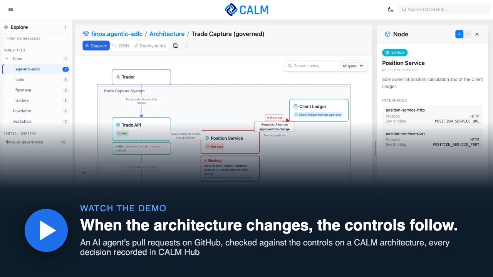
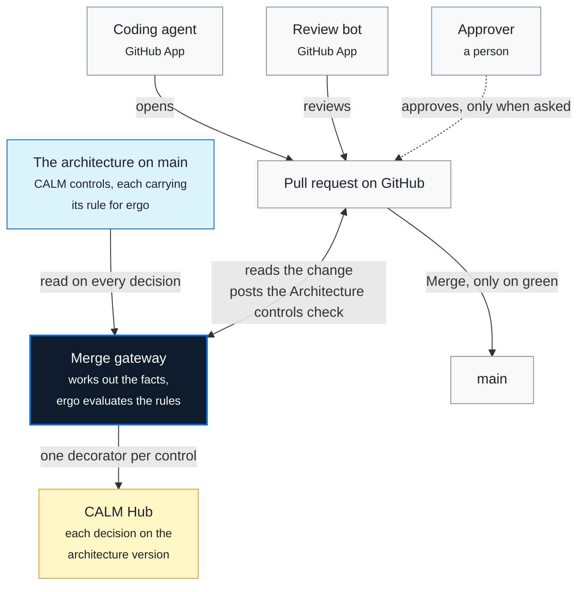
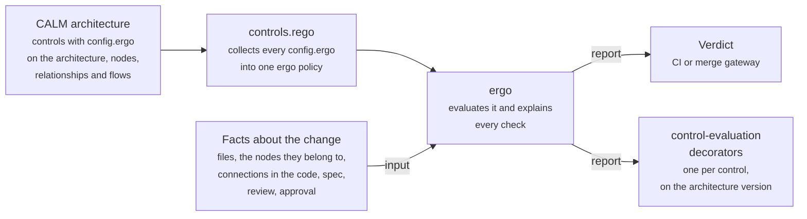

# agentic-sdlc-blueprint

**When the architecture changes, the controls follow.**

Coding agents now write and review pull requests. Which of those changes need a person? Today a reviewer decides
from memory. Here the architecture decides. The system is described in [FINOS CALM](https://calm.finos.org), and
the SDLC controls from the [FINOS SDLC Common Controls Catalog](https://sdlc-common-controls.finos.org) are
written on it. A merge gateway checks every change against those controls and records each decision back on the
architecture.

Read [the slides](https://rocketstack-matt.github.io/agentic-sdlc-blueprint/slides/) first: they set up the story
the demo plays out. Then watch the demo:

[](https://rocketstack-matt.github.io/agentic-sdlc-blueprint/slides/media/osffny-demo.mp4)

This repository is the working demo behind the talk *Governing the Agentic SDLC* (Open Source in Finance Forum,
New York, 4 November 2026; Matthew Bain and Aaron Searle). The slides are in [`slides/`](slides/), published at
[rocketstack-matt.github.io/agentic-sdlc-blueprint/slides](https://rocketstack-matt.github.io/agentic-sdlc-blueprint/slides/).

> A teaching blueprint, not a product. Fork it and take it apart.

## The idea in one example

A small trade capture system: a **Trade API**, a **Position Service**, a **Trade Store** and the **Client Ledger**,
the bank's book of record. One rule sits on the Client Ledger, in the architecture file:

> Any change to a service that connects to the Client Ledger needs a human approver.

The rule never names a service. So a change to the Position Service, which writes to the ledger, needs a person,
while a change to the Trade API goes straight through. Then an architect adds a connection from the Trade API to the
ledger. Without anyone touching the pipeline, the same kind of Trade API change now needs a person too.

Four parts make that work:

| Part | What it is | Where |
| --- | --- | --- |
| **The architecture** | The system in CALM, with the catalog's controls attached to the architecture, its nodes and relationships | [`architecture/`](architecture/) |
| **The policy** | Each control carries its rule as data, evaluated by [ergo](https://ergo.kosli.com), an open source library for Open Policy Agent that explains every decision | [`gates/policy/`](gates/policy/) |
| **The gate** | The merge gateway, plus `npm run gates` for CI | [`gateway/`](gateway/), [`gates/`](gates/) |
| **The evidence** | Every decision saved as a CALM control-evaluation decorator, on CALM Hub when it is running | [`gateway/`](gateway/) |

## How the demo works



- **The agent and the review bot** are GitHub Apps. The agent writes the code and opens the pull requests; the bot
  reviews every commit.
- **The merge gateway** is a third GitHub App, running on the presenter's laptop. On every change to a pull request it
  reads the architecture on `main`, not on the branch, so a change cannot loosen its own rules. It reports the
  **Architecture controls** check, with a comment that says why in plain words.
- **A person approves** with GitHub's own review, only when the check asks for one. The approval counts for that
  commit only, so a push after it fails the check again.
- **The architect** changes the architecture with a pull request too. It needs a person's approval, and from then on
  the gateway reads the new version.
- **CALM Hub** gets one CALM decorator per control for every decision, on the architecture version it was decided
  against.
- **`npm run gates`** runs the same evaluator in CI on every pull request to this repository.

The local demo (`npm run demo`) plays the same roles with scripts instead of GitHub: `propose.mjs` is the agent,
`review.mjs` the review bot, `approve.mjs` the person and `merge.mjs` the gateway.

## Run it locally

You need **Node 22+** and **git**. No API keys, no cloud account, no containers.

```sh
git clone https://github.com/<you>/agentic-sdlc-blueprint   # your fork
cd agentic-sdlc-blueprint
npm install
npm run demo   # the whole demo, every verdict checked: ends with "demo ok"
```

Optionally, `npm test` runs the services, gates and gateway tests, and `npm run gates` runs every blocking gate
(ADMISSIBLE on a clean tree).

`npm run demo` plays the story on a local copy of this repository (in `gateway/.demo/`): an agent proposes changes,
a review bot reviews them, a person approves where needed, and the gateway decides each merge. It records every
command and its output in `gateway/.demo/sessions.json`, then checks every verdict.

| | Change | Verdict |
| --- | --- | --- |
| 1 | The agent reviews its own Trade API change | **DENY**: the author may not review its own change |
| | The approved review bot reviews it instead | **ALLOW** |
| 2 | A Position Service change, which connects to the ledger | **DENY** until a human approves this exact commit and diff |
| | The approved change, with one more line added after approval | **DENY**: the approval no longer matches |
| 3 | The Trade API reads the ledger's file directly | **DENY**: that connection is not in the architecture |
| 4 | The architect adds Trade API → Client Ledger to the architecture | **DENY** until a human approves; then **ALLOW** |
| | The same kind of Trade API change as in 1 | **DENY**: the Trade API now connects to the ledger |

To step through it yourself, run the commands in [`gateway/run-demo.sh`](gateway/run-demo.sh) one at a time from
`gateway/`, starting with `node gateway/reset.mjs`, which also starts it again. The [gateway README](gateway/README.md)
explains each command.

The demo needs a clean working tree. It copies the last commit, so commit your changes first.

## See the decisions on the architecture (optional)

With [CALM Hub](https://github.com/finos/architecture-as-code/tree/main/calm-hub) running, the demo publishes the
architecture and every decision to it. You need Java 21+ and a checkout of
[finos/architecture-as-code](https://github.com/finos/architecture-as-code):

```sh
# in architecture-as-code/calm-hub: the backend on :8080, with embedded storage
../mvnw quarkus:dev -Pstandalone,server-only

# in architecture-as-code/calm-hub-ui: the UI on :5173
npm install && npm start

# back here
CALM_HUB_URL=http://localhost:8080 npm run demo
```

Open http://localhost:5173 and find **Trade Capture (governed)** in the `finos.agentic-sdlc` namespace. Versions
1.0.0 and 1.1.0 are the architecture before and after the architect's change, and each version carries the
decisions made against it as decorators.

CALM Hub draws those decisions on the diagram: each node and relationship shows its latest result, and in
presentation mode (larger text, for a projector) each decision is written next to it.

## The demo on GitHub pull requests (presenters)

At the talk the same story ran on real GitHub pull requests in
[rocketstack-matt/osffny-sdlc-calm](https://github.com/rocketstack-matt/osffny-sdlc-calm). That repository is
generated from this one and reset before every run. The gateway runs on the presenter's laptop as a GitHub App and
reports the **Architecture controls** check that `main` requires.

Running it against your own repository needs a one-off setup: three GitHub Apps, branch protection and the `gh` CLI
logged in. After that, `npm run demo:github` starts CALM Hub if needed, resets the repository, starts the gateway,
runs a pre-flight check and plays the demo one key at a time. `npm run demo:record` does the same start and records
the whole demo to a video instead. [`gateway/README.md`](gateway/README.md#the-github-demo) has the details.

## Try the controls yourself

- **Change the code.** Implement [`specs/SPEC-001`](specs/SPEC-001-account-summary.md) your own way, or let a coding
  agent do it, and run `SPEC=SPEC-001 npm run gates`. Agents get their instructions from [`AGENTS.md`](AGENTS.md),
  and the architecture context from `npm run calm:context -- --spec SPEC-001` or the read-only MCP server in
  [`agent/`](agent/).
- **Change the architecture.** The ledger rule is the `client-ledger-human-approval` control on the `client-ledger`
  node in [`architecture/trade-capture.architecture.json`](architecture/trade-capture.architecture.json). Its ergo
  subject's `from` line says which connections it covers. Change that, or add a relationship, then commit and run
  `npm run demo` again. The self-check lists every verdict that changed.
- **Run it in CI.** Enable Actions on your fork and open a pull request. The workflow in
  [`.github/workflows/governed-sdlc.yml`](.github/workflows/governed-sdlc.yml) runs the gates on it. Put the spec id
  (`SPEC-001`) in the pull request description.

## What enforces what

| Catalog control | Attached to | Enforced by |
| --- | --- | --- |
| SDLC-PREV-001 Code Review | the architecture | an approved reviewer who is not the author; a human approval for any change outside the services, other than docs and tests |
| SDLC-PREV-001, the Client Ledger rule | the `client-ledger` node | a human approval, bound to the commit and the diff, for any change to a service that connects to the ledger |
| SDLC-PREV-004 Requirements Repository | the architecture | every change names an approved spec in `specs/` and touches only the nodes it declares |
| SDLC-PREV-017 Service Dependency Control | the architecture | every connection the code makes is a connection in the architecture |
| SDLC-PREV-012 Deployment Gating | the architecture | `npm run gates` runs every blocking gate; any failure blocks |
| SDLC-PREV-014 Test Evidence Retention | the architecture | the decisions log, the decorators and the CI evidence bundle |

CI (`npm run gates`) evaluates the controls that apply before merge. The merge gateway evaluates them all with the
same evaluator, once the review and any approval are known.

## How CALM and ergo fit together

The rule a control enforces is written in the control itself, as an [ergo](https://ergo.kosli.com) policy in the
control's `config`. Nothing translates the architecture into a policy or keeps a second copy of the rules: the
evaluator reads the policies out of the architecture on every decision. For a step-by-step walkthrough of one pull
request, and how the same design applies to a legacy application, see
[`docs/how-calm-and-ergo-work.md`](docs/how-calm-and-ergo-work.md).



| Piece | What it does | Where |
| --- | --- | --- |
| **The ergo-control Standard** | Says what a control carrying an ergo policy looks like: `config.ergo` is an ergo policy for spec v0.6, `ergo_spec`, `subjects` and `requirements` with checks written as sentences, and is validated against [ergo's own policy schema](https://ergo.kosli.com/spec/0.6/policy.schema.json) (kept in [`architecture/standards/`](architecture/standards/) so validation runs offline). Each requirement's `meta` names the CALM control it implements (`calm-control`), the catalog control (`control-id`) and when it blocks (`stage`: `change` in CI, `merge` in the gateway, once the review and approval are known) | [`architecture/standards/ergo-control.standard.json`](architecture/standards/ergo-control.standard.json) |
| **The facts** | Works out what the change is: the files, the nodes that own them, the connections the code makes, the spec, and at merge the review and approval. ergo reads them as `$input.change` and `$input.spec`, and the architecture as `$input.architecture` | `changeInput` in [`gates/lib/calm.mjs`](gates/lib/calm.mjs), the gateway in [`gateway/gateway/`](gateway/gateway/) |
| **The bridge** | About 60 lines of Rego. Collects the `config.ergo` of every control on the architecture, its nodes, relationships and flows, merges them into one ergo policy, and runs `ergo.report`. Passes on the `ergo_spec` the policies declare. Reports a problem, which blocks, for a control with neither a policy nor `evaluated-by: pipeline`, for one whose policy names no requirement for it, and for controls that disagree on `ergo_spec` | [`gates/policy/controls.rego`](gates/policy/controls.rego) |
| **ergo** | The engine, copied unchanged from [kosli-dev/ergo](https://github.com/kosli-dev/ergo) release [rego-v0.6.0](https://github.com/kosli-dev/ergo/releases/tag/rego-v0.6.0), for spec v0.6 | [`gates/policy/ergo.rego`](gates/policy/ergo.rego) |
| **The module** | `ergo.rego` and `controls.rego` built into one Wasm module (`build.sh`, byte-reproducible, checked in CI) and run in Node with `@open-policy-agent/opa-wasm`, so the gates need no `opa` binary. The gates and the gateways take the module from the base, as they take the model, so main's policies are always evaluated by main's engine: a change that upgrades the engine is decided by the engine it replaces | [`gates/policy/controls.wasm`](gates/policy/), [`gates/lib/controls.mjs`](gates/lib/controls.mjs) |
| **The decorators** | Turns ergo's report into one control-evaluation decorator per control: met, not met or not applicable, the elements it applies to, ergo's failed checks as findings with ergo's message for each, the actors, the ergo version that decided, and hashes of the policy and the report | [`gateway/gateway/decorators.mjs`](gateway/gateway/decorators.mjs) |

### What could be contributed upstream

The engine needs no change: ergo already evaluates any policy it is given, and explains every decision. What is
specific to CALM is the glue around it, and it is general enough to live in ergo itself.

| Candidate | Upstream home | Status |
| --- | --- | --- |
| **A CALM input for ergo**: the bridge that reads the ergo policies out of a CALM architecture's controls, so any ergo user can keep their rules on the architecture | ergo, once it is contributed to FINOS | Not started. `controls.rego` is the starting point. The `meta.calm-control` link and the check that every control has a policy would come with it |
| **A CALM output for ergo**: turning an ergo report into control-evaluation decorators, so every ergo decision can be recorded on the architecture it was made against | ergo | Not started. `buildDecorators` in `decorators.mjs` is the starting point |
| **The ergo-control Standard**: the shape of a control that carries an ergo policy, including `meta.stage` | ergo, documented with the CALM input | Not started. Today its identity is a `finos.agentic-sdlc` URL that only [`architecture/url-mapping.json`](architecture/url-mapping.json) resolves |

What stays here is specific to this demo: how the facts are found (files mapped to nodes by path, connections found
by environment bindings and imports), the merge gateway and the GitHub Apps.

## Layout

```
architecture/   the CALM model, the pattern that requires the controls, Standards, offline copies of the catalog's control documents
services/       the two services the model's nodes own (Node and TypeScript, no framework)
specs/          approved specs, each pinned to the CALM nodes it may touch
gates/          npm run gates: the evaluator, the ergo policy module and their tests
gateway/        the merge gateway, the local demo (run-demo.sh) and the GitHub demo (gh-*.mjs)
agent/          architecture context for coding agents: a CLI, a read-only MCP server, the guardrails
slides/         the talk deck
docs/           how CALM and ergo work together, and how that applies to a legacy application
tools/          regenerates the catalog's CALM Hub control documents from its source
AGENTS.md       the instructions every coding agent gets
```

The pattern, the Standards and the catalog's control documents have `https://hub.calm.finos.org/...` URLs as their
identities, but nothing fetches them from a hub. [`architecture/url-mapping.json`](architecture/url-mapping.json)
maps each URL to its file in `architecture/`, and `npm run calm:validate`, the gates and the docs build pass it to
`calm` with `-u`. The files in this repository are the source of truth.

## Limitations

- **The approval is simulated.** In the local demo the approver types a code shown with the diff. In a bank that
  would be a passkey on a device the agent cannot reach. On GitHub, the approval is GitHub's own review.
- **The policy comes from the change.** CI reads the policy module and evaluator from the change itself. In a bank
  they come from a protected source.
- **Identities are names.** The agent and reviewer identities are strings in signed records, not platform-issued
  workload identities.
- **Connections are found by convention.** The service dependency control looks at environment bindings and imports
  between services. A real estate needs richer signals, such as infrastructure code, service mesh config or traces:
  see [mapping this onto a legacy application](docs/how-calm-and-ergo-work.md#mapping-this-onto-a-legacy-application).
- **Evidence storage is up to you.** Evidence goes to disk, a CI artefact and optionally CALM Hub. Immutability and
  retention are yours to provide.
- **Placing a control is a modelling decision.** The pattern can require a control, but it cannot know which node
  should carry it.

## Contributing

Your own work belongs in your fork. Issues and pull requests here are for the blueprint itself: a verdict the gateway
gets wrong, a gate that misses something, a control mapped to the wrong catalog entry. If a control looks wrong, the
better fix is usually upstream in the [catalog](https://github.com/finos/sdlc-common-controls). Licensed under
Apache 2.0.
