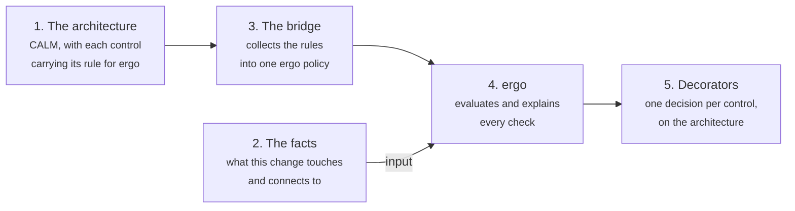
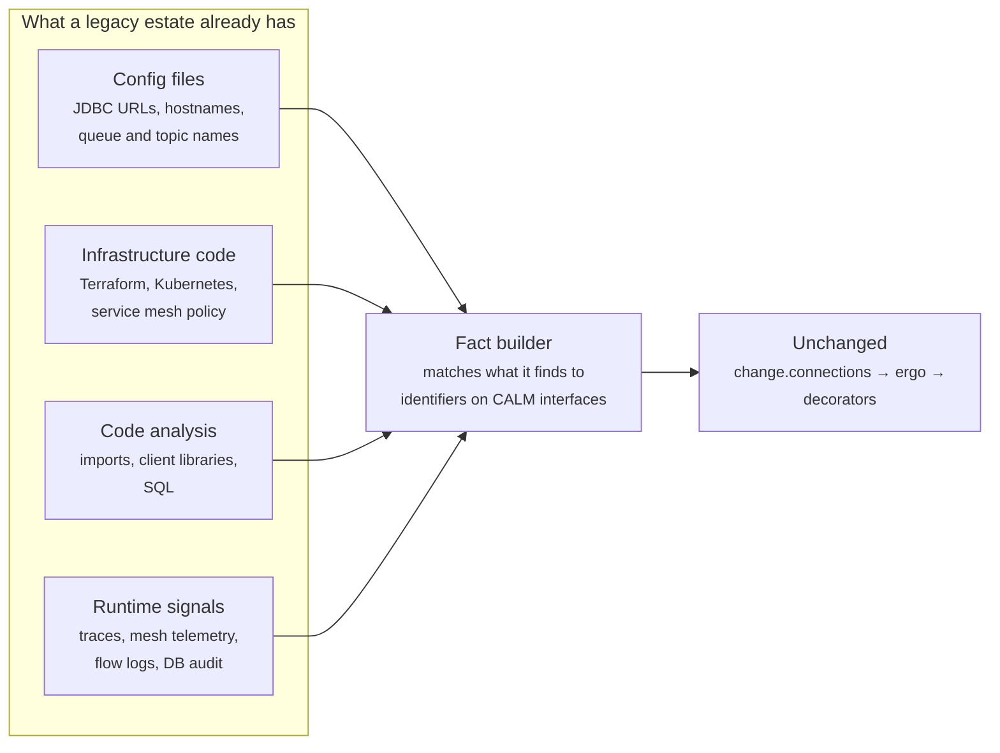

# How CALM and ergo work together

This page follows one pull request from the code to a decision recorded on the architecture, then shows how the same
design maps onto a legacy application that was never written with any of this in mind.

The short version: **the architecture holds the rules, a fact builder describes the change, ergo decides, and the
decision goes back on the architecture.** Only the fact builder knows anything about how the code is written.



## 1. The rule lives on the architecture

A CALM control can sit on the architecture as a whole, on a node, on a relationship or on a flow. Each control points
at a catalog requirement (`requirement-url`) and carries its rule, written for ergo, in `config.ergo`.

The Client Ledger's rule, shortened from
[`architecture/trade-capture.architecture.json`](../architecture/trade-capture.architecture.json):

```json
"client-ledger-human-approval": {
  "requirements": [{
    "requirement-url": "https://hub.calm.finos.org/calm/domains/finos-sdlc-common-controls/controls/sdlc-prev-001-code-review/requirement/versions/1.0.0",
    "config": {
      "control-id": "SDLC-PREV-001",
      "ergo": {
        "subjects": {
          "connection to the client ledger, changed": {
            "of": "connection",
            "applies_to": {
              "into_the_ledger":    { "op": "equals", "path": ["relationship-type", "connects", "destination", "node"], "value": "client-ledger" },
              "from_a_changed_node": { "op": "in", "path": ["relationship-type", "connects", "source", "node"], "values": { "ref": ["$$input", "change", "nodes"] } }
            }
          }
        },
        "requirements": {
          "client-ledger-human-approval": {
            "meta": { "calm-control": "client-ledger-human-approval", "stage": "merge" },
            "subject": "connection to the client ledger, changed",
            "checks": { "human_approved": { "op": "non_empty_string", "path": ["$$input", "change", "approval", "approver"] } }
          }
        }
      }
    }
  }]
}
```

Read it as: *for every relationship into the Client Ledger whose source node this change touches, a human must have
approved.* It never names a service. Which services it covers comes from the relationships in the architecture.

Every ergo rule has the same three parts:

| Part | Question it answers | In the ledger rule |
| --- | --- | --- |
| **subject** | What is being checked? | relationships in the architecture |
| **`applies_to`** | Which of those are in scope? | those into the ledger, from a node this change touches |
| **checks** | What must be true of each one in scope? | a human approved |

If nothing is in scope, the control is *not applicable*. If everything in scope passes, it is *met*. Otherwise it is
*not met*, and ergo says which check failed on which subject.

## 2. The facts describe the change

ergo only evaluates data. `changeInput` in [`gates/lib/calm.mjs`](../gates/lib/calm.mjs) works out what the change is
and hands it over as `$$input`:

| Fact | What it is | How the demo finds it |
| --- | --- | --- |
| `architecture` | The CALM model | Read from `main`, never from the pull request |
| `change.files` | Each changed file and the node that owns it | `git diff --name-only`, matched against each node's `metadata.source-path` (`services/trade-api` belongs to `trade-api`) |
| `change.nodes` | The nodes the change touches | The distinct owners of the changed files |
| `change.connections` | Every connection the code makes | Each `process.env.NAME` read is matched to the node whose interface declares `env-binding: NAME`; relative imports into another node's folder count too |
| `spec` | The spec the change names, and whether it is approved | The commit's `Spec:` trailer (or `SPEC`, which CI takes from the pull request description), looked up in `specs/` |
| `change.review`, `change.approval` | Who reviewed and who approved, at merge | GitHub reviews (the GitHub demo) or signed records (the local demo) |

### How a connection is found

The architecture gives each node an interface, and each interface names the environment variable that holds its
address:

| Node | Interface `env-binding` |
| --- | --- |
| `position-service` | `POSITION_SERVICE_URL` |
| `trade-store` | `TRADE_STORE_PATH` |
| `client-ledger` | `POSITION_STORE_PATH` |

The services read every address in their `src/config.ts`, by that exact name. So the fact builder scans the code of
each node for `process.env.NAME`, works out which node the file belongs to and which node owns `NAME`, and writes down
the connection. Think of the architecture as the list of which key opens which room: when code asks for a key, the
gateway knows which room it is going into.

A name that no interface declares still produces a connection, with destination `null`. No relationship has a `null`
destination, so an unknown connection is not met: it is treated as not in the architecture.

## 3. The bridge collects the rules

[`gates/policy/controls.rego`](../gates/policy/controls.rego) is about 60 lines of Rego. On every decision it walks
the controls on the architecture, its nodes, relationships and flows, merges every `config.ergo` into one ergo policy
and runs it. It also reports a problem, which blocks, for any control that has neither a rule nor
`evaluated-by: pipeline`. There is no second copy of the rules anywhere: change the control in the architecture and
the next decision uses it.

## 4. ergo decides

[ergo](https://ergo.kosli.com) is an open source library for Open Policy Agent that explains every decision. It
evaluates the policy against the facts and returns a report: every requirement, every subject in scope, every check,
and for each failure the expression that failed and why.

Each requirement's `meta.stage` says when it can block. `change` rules (the spec, the service dependency) can be
decided from the code alone, so CI blocks on them. `merge` rules (code review, the ledger approval) need the review and
approval, so only the merge gateway, which evaluates every rule, can decide them.

## 5. The decision goes back on the architecture

[`gateway/gateway/decorators.mjs`](../gateway/gateway/decorators.mjs) turns ergo's report into one CALM
control-evaluation decorator per control. It is pinned to the architecture version the decision was made against,
and to the elements the control was about. With CALM Hub running, each decorator is saved there and shown on the
diagram.

## Worked example: the shortcut

In the GitHub demo (moment 5), the agent takes a shortcut and adds one line to
`services/trade-api/src/config.ts`:

```ts
ledgerPath: process.env.POSITION_STORE_PATH ?? 'data/positions.json',
```

1. **Files.** The only changed file is under `services/trade-api`, so `change.nodes` is `["trade-api"]`.
2. **Connections.** The scan reads all the code, not only the diff, so it lists the three connections that are
   already in the architecture. It also finds `POSITION_STORE_PATH` in a `trade-api` file, and the architecture says
   `client-ledger` owns that name:

   ```json
   { "id": "trade-api->client-ledger", "source": "trade-api", "destination": "client-ledger",
     "evidence": "services/trade-api/src/config.ts:9 env POSITION_STORE_PATH" }
   ```

3. **ergo.** The service dependency control (SDLC-PREV-017) checks every connection the code makes against the
   `connects` relationships. There is `trade-api → trade-store` and `trade-api → position-service`, but no
   `trade-api → client-ledger`. The check `in_architecture` fails.
4. **The decorator.** The decision is saved on the architecture (shortened):

   ```json
   {
     "type": "control-evaluation",
     "applies-to": ["trade-api"],
     "data": {
       "control": { "unique-id": "sdlc-prev-017-service-dependency", "control-id": "SDLC-PREV-017", "attached-to": "trade-capture" },
       "status": "not-met",
       "findings": [{
         "subject": "trade-api->client-ledger",
         "check": "in_architecture",
         "description": "The architecture has this connection",
         "cause": "absent"
       }]
     }
   }
   ```

The pull request can't fix this by adding the relationship itself, because the gateway reads the architecture from
`main`. An architect has to change the architecture in a pull request of its own, which needs a human approval. Once
that merges, `trade-api → client-ledger` exists, so two things change at once, with nobody touching the shortcut's
pull request or the pipeline (moment 7):

- The gateway decides the open shortcut again, against the new `main`. SDLC-PREV-017 is now met: the connection is
  in the architecture.
- The ledger rule's `applies_to` now matches any change to the Trade API, so the shortcut needs a person. Once Aaron
  approves, it merges.

## Mapping this onto a legacy application

The demo is small and tidy on purpose: every service has its own folder, and every connection goes through a named
environment variable. A legacy estate has none of that. What matters is that **only step 2 depends on how the code is
written.** The controls, the bridge, ergo and the decorators stay exactly as they are. The rule
`every connection the code makes is in the architecture` doesn't care how the connection was found.



The demo relies on three conventions. Each one has a legacy equivalent:

| The demo relies on | A legacy equivalent |
| --- | --- |
| **Which code belongs to which node:** one folder per node (`metadata.source-path`) | One repository per node, build modules, `CODEOWNERS`, or the deployment unit (the container image or artifact that a node's Kubernetes deployment runs) |
| **What a connection looks like:** a `process.env` read whose name is an interface's `env-binding` | Whatever identifies the other end. Put that identifier on the node's CALM interface, the same way `env-binding` is there today: a hostname and port, a URL, a database DSN, a queue or topic name. Then match what the code, config and infrastructure reference against those identifiers |
| **An architecture to compare against:** written by hand | Generated from the same discovery sources, then reviewed and curated by architects. Start by describing what exists, not by redesigning it |

For example, a Java service with `spring.datasource.url=jdbc:oracle:thin:@ledger-db.prod:1521/LEDGER` in its
`application.properties`. If the Client Ledger's interface records `ledger-db.prod` and port `1521`, a fact builder
that reads Spring config produces the same fact the demo does: `{ source: "trade-api", destination: "client-ledger" }`.

### Where the facts come from changes what they can do

| Source | When | Good at | Misses |
| --- | --- | --- | --- |
| **Static**: config, infrastructure code, code analysis | In CI, on the pull request | Blocking a change before it merges | Computed hostnames, connections hidden in shared libraries, reflection, service discovery |
| **Runtime**: OpenTelemetry traces, service mesh telemetry, eBPF, network flow logs, database audit logs | After deployment | Seeing what actually talks to what, including what static analysis missed | Anything not yet deployed, so it finds drift rather than preventing it |

The strong version uses both. Static facts gate the pull request. Runtime facts are evaluated against the same
controls on a schedule, and the decisions are recorded as decorators, so drift shows up on the architecture in CALM
Hub with the connection that caused it.

### Rolling it out

A new fact builder will find connections the architecture doesn't have yet. Most are real but undocumented, not
breaches. A sensible order:

1. **Report only.** Evaluate and publish the decorators, but don't block. This repository has no switch for that
   today; it would be a setting in the gateway or CI on which verdicts fail the check.
2. **Close the gaps.** For each finding, either add the relationship to the architecture (with an architect's
   approval) or remove the connection from the code.
3. **Block.** Once the architecture matches reality, turn the control to blocking, starting with the systems that
   matter most, such as a book of record.

### The limit to be honest about

No detector sees every connection. The control is only as complete as the facts it is given. What CALM and ergo add
is that the rule, the facts it used and the decision are all explicit and recorded on the architecture, so a missed
connection is a gap in a known detector, not a gap in someone's memory.
